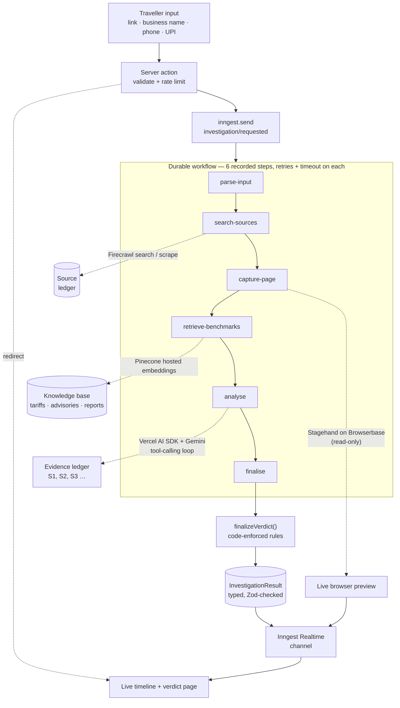
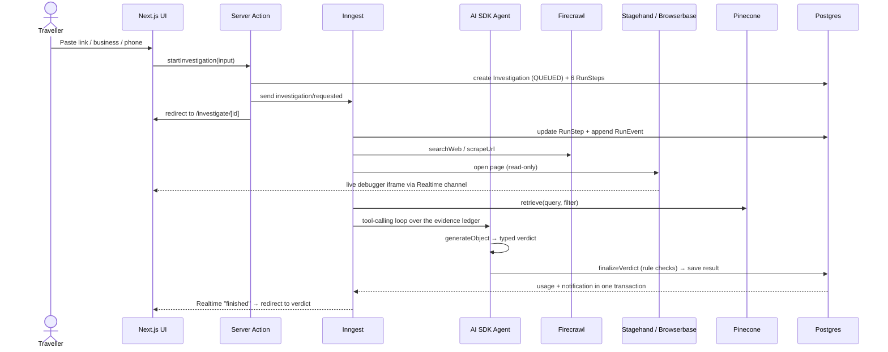
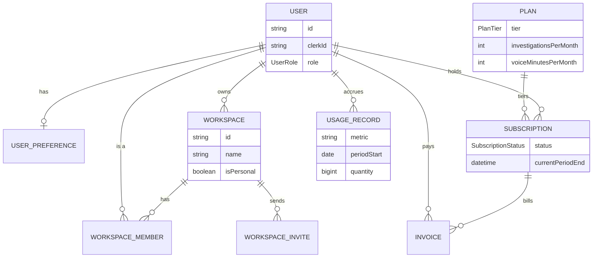
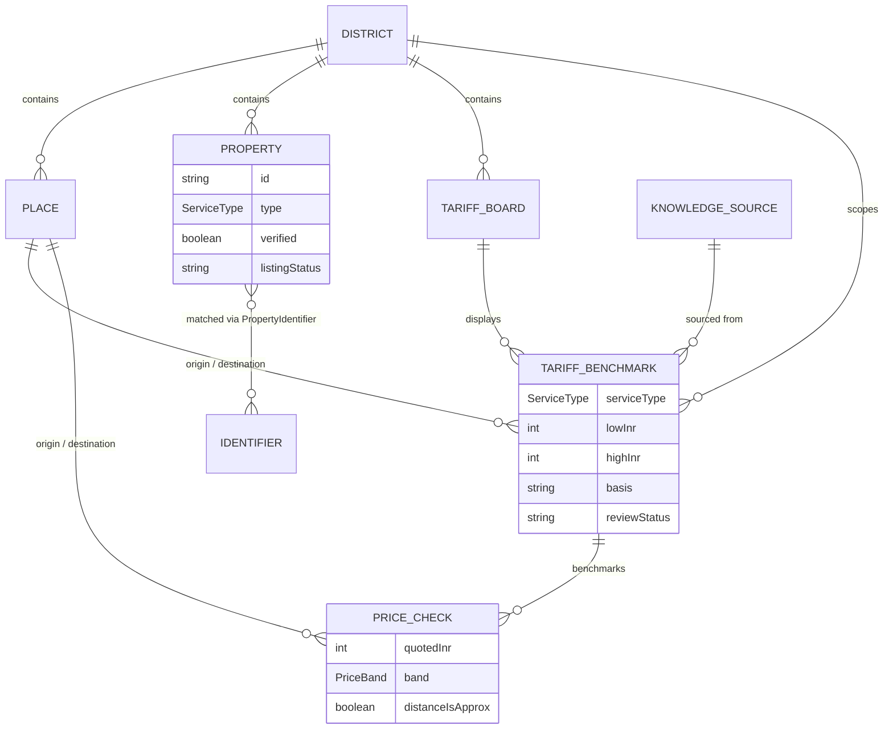
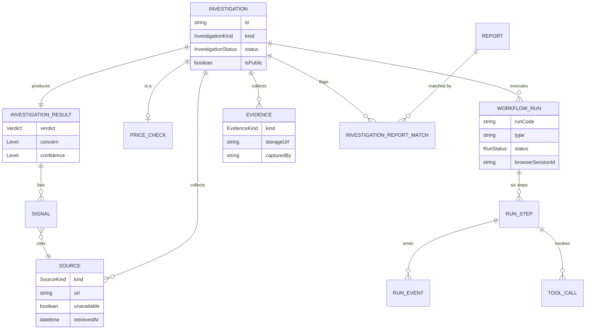
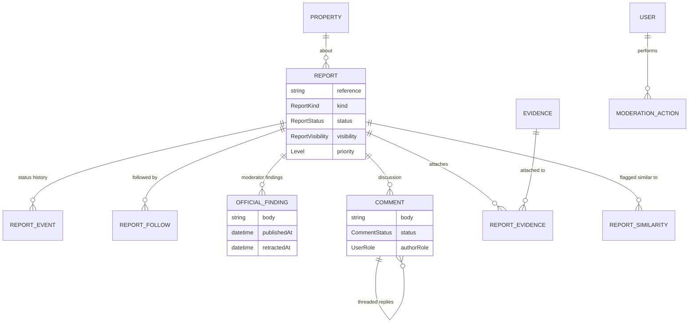
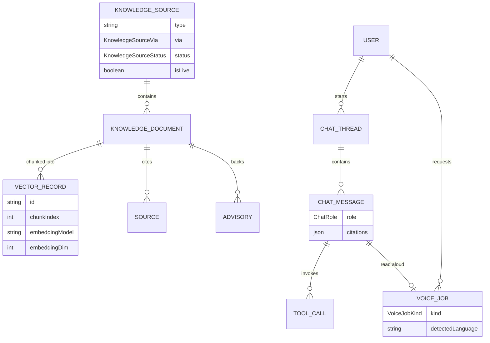

# DorCheck — Know the Local Rate

**AI price intelligence and scam investigation for travellers in Northeast India.**

Every year, travellers to Assam, Meghalaya, and the rest of Northeast India get quoted taxi fares, "guide" packages, and homestay rates with no way to tell a fair local price from a tourist markup — and no way to check whether a listing is even real before they pay. DorCheck is the layer that was missing: an agent that goes and checks, with receipts.

Paste a link, a phone number, or a quoted price. DorCheck's AI agent researches the web, reads the actual page in a live browser, cross-references a tariff database and a community report history, and comes back with a verdict — **with every claim traced to a numbered, timestamped source.** No source, no claim. That rule is enforced in code, not just in the prompt.

---

## The problem, concretely

- A traveller gets quoted ₹4,800 for an airport taxi that should cost ₹1,200. There's no public benchmark to check it against.
- A "tour operator" website looks legitimate. There's no quick way to verify it's a real, reviewed business versus a look-alike domain set up last week.
- Scam reports from other travellers exist, scattered across forums and group chats — never structured, never searchable, never connected to the business that caused them.

DorCheck turns "is this a rip-off?" and "is this real?" into a 60-second, evidence-backed answer.

## What it does

| Feature | What happens under the hood |
|---|---|
| **Price Check** | Any taxi route, stay, guide, or tour. Curated tariffs → saved research → live web research (3 independent sources must agree) → distance-fitted estimate, in that priority order. Every number keeps its source and confidence tier. |
| **Investigate** | Full agentic investigation of a link, business, or contact. Watch it work live: a real browser opens the page (read-only — it never clicks, types, or pays anything), the agent cross-checks the business directory, pulls matching community reports, and searches the web, all streamed to the screen step by step. |
| **Verdict** | A typed, ruled result — verdict, confidence, signals, sources, guidance — never free-form prose the model could hallucinate into an accusation. Shareable, printable, and always carries the baseline safety guidance (1930 / cybercrime.gov.in). |
| **Evidence Vault** | Every screenshot and upload, privately stored, with signed access links — nothing is public by default. |
| **Knowledge Base** | Tariffs, directory listings, advisories, and past reports, embedded and searchable by meaning, in English or regional languages. |
| **Community Reports** | Travellers file reports (text or voice, auto-translated); moderators review and verify; reports automatically strengthen future investigations. |
| **Assistant + Voice** | A chat assistant with the same tool access as the investigation agent, plus text-to-speech and speech-to-text for voice-first reporting. |
| **Explore Map** | A live 3D map of verified businesses, tariff zones, and flagged reports across the region. |

## Why this is hard (and why it's not a wrapper)

The headline risk of any "AI agent that makes judgments about real businesses" project is that it hallucinates a claim with no backing and calls someone a scammer. DorCheck's whole architecture is built around closing that gap:

- **Evidence ledger, not free text.** Every tool call — web search, page scrape, directory lookup, knowledge retrieval — registers what it found as a numbered, citable source (`S1`, `S2`, …) *before* the model ever writes a sentence. The model cites ids; it never writes a URL itself, so it structurally cannot invent a source.
- **Rules enforced in code, after the model.** A `VERIFIED_MATCH` verdict requires a cited exact directory match. A `SUSPICIOUS` verdict requires a cited risk signal. Confidence is capped when sources are thin or unverified. Accusatory language ("is a scammer") is rewritten to "this is a signal, not a legal finding" before it ever reaches a screen.
- **Read-only browser automation.** The agent's live browser (Stagehand on Browserbase) can navigate, scroll, and read — it is never permitted to type, submit, or click pay/confirm. Unsafe URLs and private IP ranges are blocked before every navigation.
- **Prompt-injection aware.** Scraped page text and user messages are fenced as untrusted data; an instruction hidden inside a scraped page is treated as a risk signal, not an instruction.
- **Durable by default.** The entire investigation — six steps, every retry, every tool call — runs as an Inngest workflow, so a flaky page or a timed-out API call degrades the confidence of one signal instead of crashing the whole run.

This is the difference between "an LLM that answers questions about scams" and a system you'd actually trust with a judgment that affects someone's trip and someone's business reputation.

## Architecture





## Tech stack

| Layer | Choice | Why |
|---|---|---|
| Framework | Next.js 16 (App Router) + React 19 | Server components for data-heavy screens, streaming UI for live agent runs, React Compiler enabled |
| Language | TypeScript, end to end | Prisma-generated types flow unmodified from the database into server actions into React |
| Agent + LLM | Vercel AI SDK (`ai`, `@ai-sdk/google`) + Google Gemini | `ToolLoopAgent` gathers evidence, a separate `generateText` + `Output.object` pass writes the typed verdict |
| Durable execution | Inngest | Retries, per-user concurrency limits, cancellation, and Realtime pub/sub for live progress — no custom queue code |
| Web research | Firecrawl (`@mendable/firecrawl-js`) | Clean markdown extraction with URL + timestamp on every result; domain allow/deny list |
| Browser automation | Stagehand v4 on Browserbase | AI-driven, read-only browser session with a live, embeddable debugger view (`sessions.debug`) |
| Vector search | Pinecone (`@pinecone-database/pinecone`, hosted `llama-text-embed-v2`) | Integrated index — the app sends text, Pinecone embeds it; no separate embedding API calls |
| Database | PostgreSQL + Prisma 7 (54 models) | Full investigation, evidence, report, and moderation audit trail; `@prisma/adapter-pg` driver adapter |
| Auth | Clerk (`@clerk/nextjs`, `@clerk/ui`) | Roles (traveller / moderator / admin), webhook-synced `User` rows, Clerk Billing for plans |
| Storage | Cloudflare R2 via the S3 API (`@aws-sdk/client-s3`) | Private bucket by default; every file served through short-lived signed links |
| Maps | Mapbox GL (`mapbox-gl`) | 3D terrain, pitched view, live-traffic-aware routing, Geocoding + Search Box APIs |
| Chat / community | Stream (`stream-chat`) | Discussion threads on reports, mirrored into Postgres for moderation and audit |
| Voice | ElevenLabs (`@elevenlabs/elevenlabs-js`) | Speech-to-text for voice reports, text-to-speech for read-aloud verdicts, cached by content hash |
| UI | shadcn/ui + Radix + Tailwind v4 | Installable PWA (manifest + service worker), works offline for cached pages |
| Validation | Zod + `@t3-oss/env-core` | Every server action input, tool schema, and env var is parsed, not assumed |
| Testing | Vitest + scripted mock-model tests | Unit tests for the price engine and agent rules; separate `test:*` scripts hit live services end to end |

## Data model

The schema is intentionally boring where it can be (closed state machines are enums, open catalogues are validated strings) so the team migrates once instead of once per feature. 54 Prisma models, grouped here by the part of the product they serve — see [`prisma/schema.prisma`](prisma/schema.prisma) for the full source of truth.

<details>
<summary><strong>Identity, workspaces & billing</strong></summary>


</details>

<details>
<summary><strong>Directory & pricing engine</strong></summary>


</details>

<details>
<summary><strong>Investigations & agent runs</strong></summary>


</details>

<details>
<summary><strong>Community reports & moderation</strong></summary>


</details>

<details>
<summary><strong>Knowledge base, assistant & voice</strong></summary>


</details>

## Try it

1. **Price Check** — paste any two places in Assam or Meghalaya and a quoted fare. Get a range, a confidence level, and the sources behind it.
2. **Investigate** — paste a suspicious booking link. Watch the live browser open it, watch the evidence pile up, get a verdict you can actually defend.
3. **Explore Map** — see verified businesses and flagged reports across the region in 3D.

```bash
npm install
cp .env.example .env.local   # fill in the keys listed there
npm run db:reset             # seeded demo data in under a minute
npm run dev
npm run inngest:dev          # separate terminal — powers every durable workflow
```

## What's real vs. demo

Properties, tariffs, and reports ship seeded with demo data so every screen is populated out of the box (`isDemo` flag, reversible with `npm run db:reset`). Everything else — the agent, the workflows, the price research pipeline, the knowledge base, the live browser — runs against live external services, not mocks. Flip off the demo banner and point it at a real district and it keeps working the same way.

## Contributing

DorCheck is a 54-model, agent-heavy app — the guardrails below exist because an unreviewed change to the verdict rules or the evidence ledger has real-world consequences (a wrong "scammer" signal on a real business), not just a failing test.

### Getting set up

1. Follow **Try it** above to get a seeded database and `npm run dev` + `npm run inngest:dev` running side by side.
2. Copy `.env.example` → `.env.local` and fill in only the keys the area you're touching needs; most free tiers are enough for local work (see `plan.md` Phase 0 for where to get each key).
3. Never commit secrets. `.env*` is gitignored — if you add a new required key, add its name (no value) to `.env.example`.

### Before you open a PR

- **Run the relevant tests.** `npm test` (Vitest, no external calls) must pass for any change. If you touched the price engine, the agent, the investigation workflow, voice, settings, or moderation, also run its `test:*` script (see `package.json`) — most need `npm run dev` + `npm run inngest:dev` running and will spend a small amount of real API credit.
- **Database changes go through Prisma migrations**, never hand-edited SQL: `npm run db:migrate --name <change>`. Re-run `npm run db:seed` / `db:reset` locally to confirm the seed still matches the schema.
- **Respect the evidence ledger.** If a change touches `server/agent*.ts` or `lib/verdict.ts`: every claim the model can make must trace back to a numbered `Source` row created by a tool, and `finalizeVerdict` is the only place verdict rules live — don't duplicate rule logic in the UI.
- **Respect the read-only browser policy.** `server/capture.ts` and anything using Stagehand may navigate, scroll, and read. It must never gain `act()`-style write capability (typing, submitting, clicking pay/confirm) without an explicit, separate security discussion — this is a product guarantee, not an implementation detail.
- **Loading and empty states are not optional.** Every route that reads data needs a `loading.tsx` skeleton matching its layout, every async action shows progress in the triggering button, and every empty list uses the shared empty-state component with a next action. This is existing repo convention (`plan.md`, "Loading and empty states"), not a nice-to-have.

### Code style

- No speculative abstractions: three similar lines beat a premature helper. Don't build for a future requirement that isn't there yet.
- No comments that restate the code. A comment is only worth adding when it captures a non-obvious *why* — a workaround, an invariant, a constraint from an external API — the kind of thing a future reader can't get from the code itself.
- Validate at system boundaries (user input, external API responses, tool outputs) with Zod; trust internal functions and Prisma's generated types instead of re-checking them.
- Prefer extending an existing server module (`src/server/*.ts`) over adding a new one — check whether the domain you're touching already has a home before creating a file.
- TypeScript strict, no `any` as a shortcut past a real type error.

### Commits & PRs

- Small, focused commits over one large one; write the message around *why*, not a restatement of the diff.
- New commits, not amended ones, once a commit has been pushed or reviewed.
- In the PR description, call out which `test:*` scripts you ran (or why none applied) — reviewers can't tell from the diff whether the live agent path was exercised.
- If a change affects a moderator-only surface (`/moderation`, `/workflows`, `/knowledge`), note it explicitly — these are the parts of the app a traveller never sees but that keep the data trustworthy.

---

*Built as a full-stack, agentic application, not a thin UI over a single API call: 54 database models, a durable multi-step workflow engine, a rule-audited AI agent, live browser automation with a public preview, semantic search, and a full community moderation loop — shipped end to end.*
